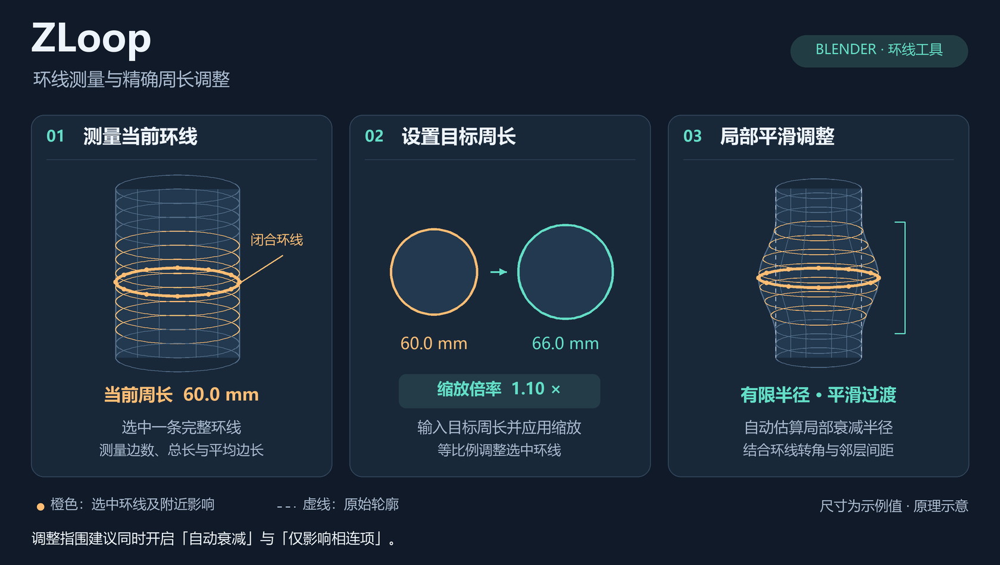
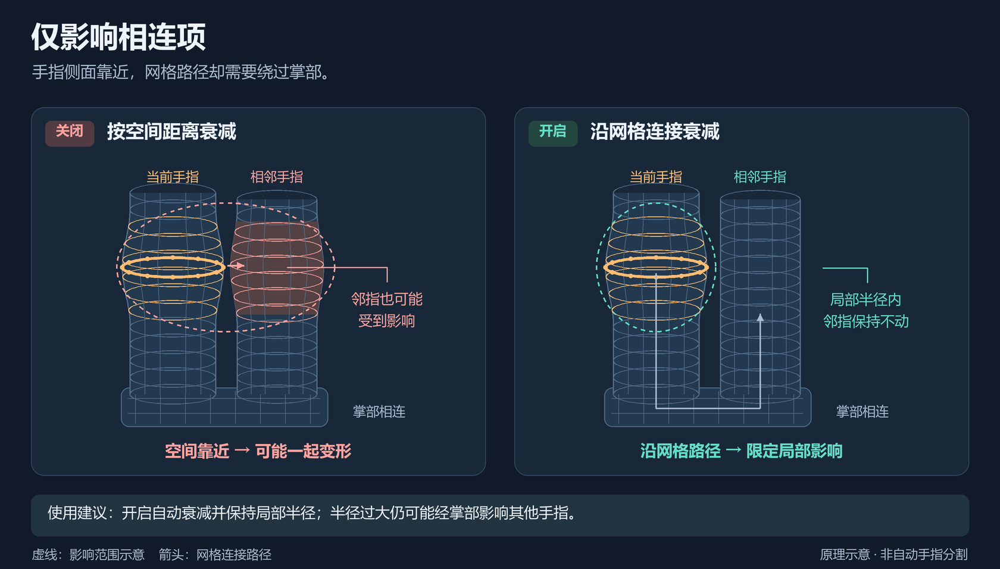

# ZLoop 功能图解

以下是说明操作与原理的示意图。尺寸为示例值，影响范围与形状经过简化，实际变形取决于所选网格、目标周长、半径及衰减类型。

## 测量 → 目标周长 → 局部调整

1. **测量当前环线**：在编辑模式选中一条完整闭合环线。橙色粗线和顶点标出选中的环线，点击测量按钮可查看边数、总长度和平均边长。
2. **设置目标周长**：示例从 60.0 mm 调整到 66.0 mm，缩放倍率为 `66 ÷ 60 = 1.10`。周长按物体变换后的坐标计算；数值对应周长，不能理解为直径。
3. **局部平滑调整**：周围未选中顶点按比例编辑衰减移动，越接近影响范围边缘，影响越小。虚线表示原始轮廓，橙色环线表示调整后的中心截面。自动半径结合环线转角、边长和邻层间距估算，不自动重建曲面。

原始矢量图：[feature-overview.svg](images/feature-overview.svg)。

## 为什么靠近的邻指会被带动

- **关闭“仅影响相连项”**：按空间距离计算影响。相邻手指虽然未被选中，但部分顶点可能进入衰减范围，随当前环线移动。
- **开启“仅影响相连项”**：按网格连接传播影响。相邻手指到选中环线的连接路径需要经过掌部；在局部半径内，邻指不会仅因靠近就被调整。
- **半径仍然重要**：两根手指属于同一张相通的网格，半径过大仍可能经掌部传到其他手指。图中的箭头展示连接路径，虚线概括局部影响范围，不是自动识别出的手指边界。

调整指围建议同时开启“自动衰减”与“仅影响相连项”。该选项支持自动半径和手动半径，默认开启。

原始矢量图：[connected-falloff.svg](images/connected-falloff.svg)。

## 图像维护

图像由 [draw_feature_diagrams.py](../tools/draw_feature_diagrams.py) 生成。修改功能后同步图解和 README，确保说明与当前行为一致。生成方法见 [维护流程](MAINTENANCE.md#维护示意图)。
